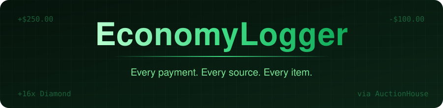
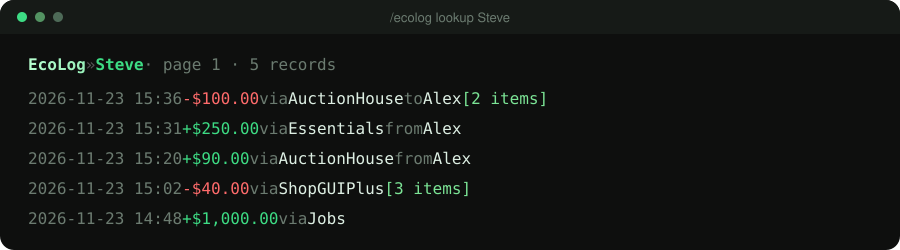

<div align="center">
  

  <h3>Know exactly where every coin on your server came from.</h3>

  <a href="https://github.com/Xenos-core/EconomyLogger/actions"></a>
  <a href="https://github.com/Xenos-core/EconomyLogger/releases"></a>
  
  
  <br>
  
  
</div>

<br>

EconomyLogger sits between your plugins and your economy and writes down every transaction:
who got paid, who paid them, which plugin moved the money and what items changed hands with it.
Then it puts it all in a clean in-game menu, so the next time someone asks *"where did this guy get
40 million from?"* you have the answer in two clicks.

<div align="center">
  
  <br><sub>Example of <code>/ecolog lookup</code> output</sub>
</div>

<h3>Features</h3>

- **Every Vault call.** Deposits and withdrawals from any plugin, along with the plugin that made them
- **Player to player.** Payments get linked both ways: Steve sees *from Alex*, Alex sees *to Steve*.
  This works for `/pay`, trades and auction houses, tax included
- **Items too.** Buy something from an auction house and the log shows the money *and* the
  16 diamonds you got for it, with enchants and names kept
- **What they were doing.** The command or menu used right before the payment (`/ah sell 500`, `menu: Auction House`)
- **EssentialsX.** `/pay`, `/eco` and `/sell` get picked up from Essentials' own events, never logged twice
- **The GUI.** Totals, filters (in, out, payments, items), time periods, and a *where money comes from*
  page that breaks income down by plugin and by trading partner
- **Built for big servers.** Batched SQLite writes on a background thread mean no disk work on the main
  or region threads. It adds a few microseconds per economy call
- **Configurable.** Colors, titles, slots, materials, sounds and messages are all in plain YAML

<h3>Requirements</h3>

| | |
|---|---|
| Server | Paper or Folia: 1.21.11, 26.1.2, 26.3 |
| Java | 21 or newer |
| Economy bridge | [Vault](https://github.com/MilkBowl/Vault) on Paper, [VaultUnlocked](https://github.com/TheNewEconomy/VaultUnlocked) on Folia |
| Optional | [EssentialsX](https://github.com/EssentialsX/Essentials) |

You also need an economy plugin, such as EssentialsX or CMI. EconomyLogger doesn't replace it, it just watches it.

<h3>Installation</h3>

1. Grab the jar from [Releases](https://github.com/Xenos-core/EconomyLogger/releases)
2. Drop it in `plugins/` next to Vault (or VaultUnlocked)
3. Restart. There's nothing to set up, logging starts right away
4. Run `/ecolog stats` to check it hooked your economy

<h3>Commands & permissions</h3>

| Command | What it does | Permission | Default |
|---|---|---|---|
| `/ecolog` | Open your own log | `economylogger.use` | everyone |
| `/ecolog <player>` | Open someone else's log | `economylogger.others` | op |
| `/ecolog lookup <player> [page]` | Chat/console lookup | `economylogger.lookup` | op |
| `/ecolog stats` | Hook status, queue, database size | `economylogger.admin` | op |
| `/ecolog reload` | Reload all configs | `economylogger.admin` | op |

Aliases: `/elog`, `/economylog`

<h3>Configuration</h3>

| File | What's in it |
|---|---|
| `config.yml` | What to track, payment pairing, item tracking, storage and retention, number format |
| `gui.yml` | Theme colors, every menu title, item, lore line, slot and sound |
| `messages.yml` | Chat messages |

The default theme is a green gradient (`#B6FFCF` → `#3DDC84` → `#0FA958`). Swap the hex codes in
`gui.yml` to make it match your server.

<details>
<summary><b>How it works</b></summary>
<br>

On startup EconomyLogger registers its own `Economy` with Vault at the highest priority, wrapping the
real one. Plugins that ask Vault for the economy get the wrapper, so every call goes through it. The
real economy still does all the work, and the wrapper only reads the result.

- The calling plugin is found from the call stack and cached per class
- When the same plugin withdraws from Y and deposits to X on the same thread within `pairing.window-ms`,
  the two are linked as a payment
- For online players, the inventory gets snapshotted when money moves and compared a couple of ticks later,
  on the player's own region thread on Folia
- Records go into a queue and get written in batches to `transactions.db` (SQLite, WAL mode). Menu
  queries run on a separate reader thread

</details>

<details>
<summary><b>Known limits</b></summary>
<br>

- Plugins that change balances without Vault or Essentials (a private internal economy) can't be seen
- Plugins that only use the VaultUnlocked v2 API (`net.milkbowl.vault2`) skip the wrapper
- If another plugin registers an economy at Highest priority, `/ecolog stats` will say it's being bypassed
- Items sent to a mailbox instead of the inventory don't show up in the item diff

</details>

<h3>Building</h3>

```bash
git clone https://github.com/Xenos-core/EconomyLogger.git
cd EconomyLogger
mvn package
```

The jar ends up in `target/`. Every push also gets built by
[GitHub Actions](https://github.com/Xenos-core/EconomyLogger/actions).

<h3>License</h3>

[MIT](LICENSE)
